
<a href="https://www.abdelhmeed.com"><picture><source media="(max-width: 600px)" srcset="assets/m-hero.svg"></picture></a>

<b>Creative engineer</b> from Minya, Egypt. Server Administrator at <b>Amwag Travel</b> (previously IT Help Desk). 
Computer Science & AI student, Minya National University. Founder of DÖSE, an Egyptian niche fragrance house. 
Bilingual product builder (Arabic / English) · Cybersecurity enthusiast

<a href="https://cortex-pi-sable.vercel.app"><picture><source media="(max-width: 600px)" srcset="assets/m-project-cortex.svg"></picture></a>

<a href="https://www.abdelhmeed.com/work/dose-fragrance.html"><picture><source media="(max-width: 600px)" srcset="assets/m-project-dose.svg"></picture></a>

<a href="https://www.abdelhmeed.com/work/amwag-attendance.html"><picture><source media="(max-width: 600px)" srcset="assets/m-project-attendance.svg"></picture></a>

<a href="https://r5depifinalproject.vercel.app"><picture><source media="(max-width: 600px)" srcset="assets/m-project-bosla.svg"></picture></a>

<a href="https://cortex-ops.vercel.app"><picture><source media="(max-width: 600px)" srcset="assets/m-project-cortex-ops.svg"></picture></a><a href="https://github.com/abameda/3D-Cloth-App"><picture><source media="(max-width: 600px)" srcset="assets/m-project-thread.svg"></picture></a>

<a href="https://sms-mnu.vercel.app"><picture><source media="(max-width: 600px)" srcset="assets/m-project-mnu-sms.svg"></picture></a><a href="https://github.com/abameda/Amwag-Printer-Driver"><picture><source media="(max-width: 600px)" srcset="assets/m-project-printer.svg"></picture></a>

<a href="https://github.com/abameda/Yosr-LMS"><picture><source media="(max-width: 600px)" srcset="assets/m-project-yosr.svg"></picture></a>

<a href="https://github.com/abameda?tab=repositories"><picture><source media="(max-width: 600px)" srcset="assets/m-toolbox.svg"></picture></a>

<a href="https://github.com/abameda"><picture><source media="(max-width: 600px)" srcset="assets/m-census.svg"></picture></a>

<a href="https://github.com/abameda"><picture><source media="(max-width: 600px)" srcset="assets/m-station-hall.svg"></picture></a><a href="https://www.abdelhmeed.com"><picture><source media="(max-width: 600px)" srcset="assets/m-station-website.svg"></picture></a><a href="https://www.linkedin.com/in/elshorbagy/"><picture><source media="(max-width: 600px)" srcset="assets/m-station-linkedin.svg"></picture></a><a href="https://www.abdelhmeed.com/assets/Abdelhmeed-Elshorbagy-CV.pdf"><picture><source media="(max-width: 600px)" srcset="assets/m-station-cv.svg"></picture></a><a href="https://github.com/abameda"><picture><source media="(max-width: 600px)" srcset="assets/m-station-github.svg"></picture></a>

Every building is a real project. The lights, the towers and the census are rebuilt daily from live GitHub data. Last census: 10 NOV 2026.

This profile exists in three worlds: <b>The City</b> · <a href="https://github.com/abameda/abameda/tree/main/worlds/circuit#readme">The Circuit Board</a> · <a href="https://github.com/abameda/abameda/tree/main/worlds/blueprint#readme">The Blueprint</a>

