<!-- THE BLUEPRINT · generated by build.mjs from profile.json + data.json (2026-11-13). Do not edit by hand. -->

<a href="https://www.abdelhmeed.com">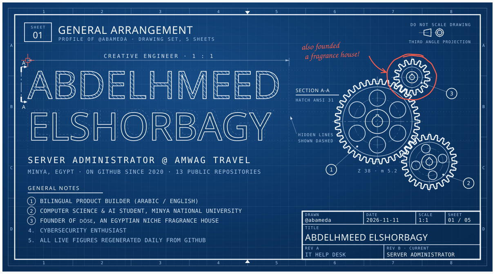</a>

<b>Abdelhmeed Elshorbagy</b> · Creative engineer · Server Administrator @ Amwag Travel · Minya, Egypt Computer Science &amp; AI student, Minya National University · Founder of DÖSE

<a href="https://cortex-pi-sable.vercel.app"><picture><source media="(max-width: 600px)" srcset="assets/p-cortex-m.svg">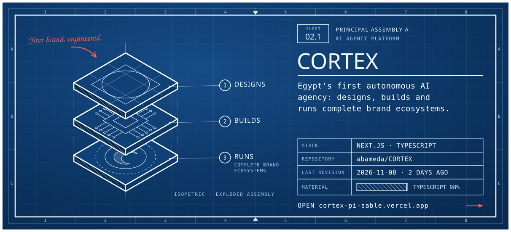</picture></a>

<a href="https://www.abdelhmeed.com/work/dose-fragrance.html"><picture><source media="(max-width: 600px)" srcset="assets/p-dose-m.svg"></picture></a>

<a href="https://www.abdelhmeed.com/work/amwag-attendance.html"><picture><source media="(max-width: 600px)" srcset="assets/p-attendance-m.svg">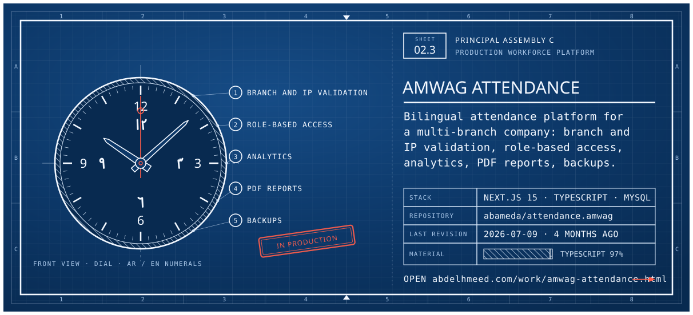</picture></a>

<a href="https://r5depifinalproject.vercel.app"><picture><source media="(max-width: 600px)" srcset="assets/p-bosla-m.svg">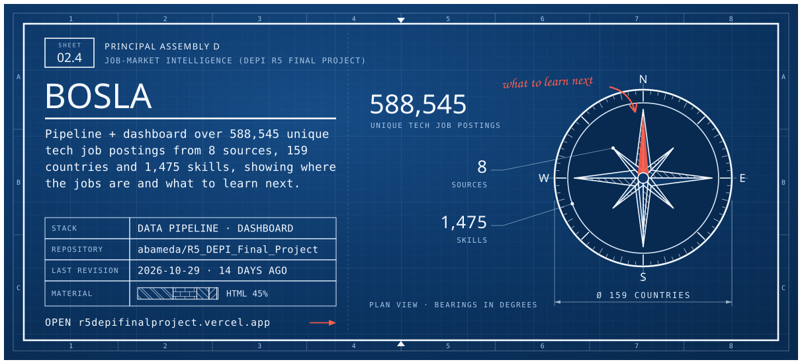</picture></a>

<a href="https://cortex-ops.vercel.app">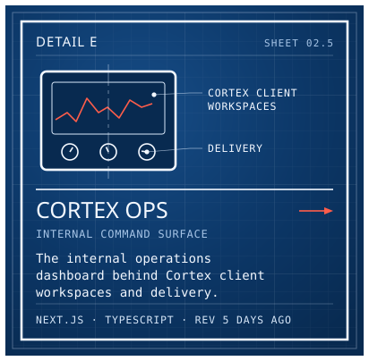</a><a href="https://github.com/abameda/3D-Cloth-App">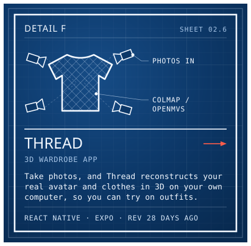</a><a href="https://sms-mnu.vercel.app">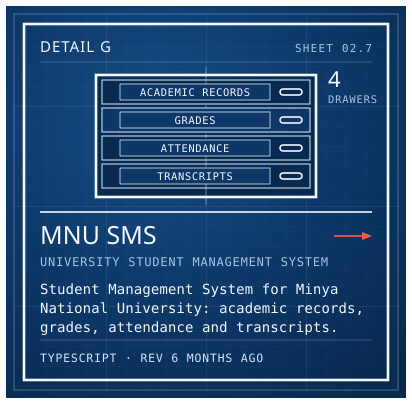</a>

<a href="https://github.com/abameda/Amwag-Printer-Driver">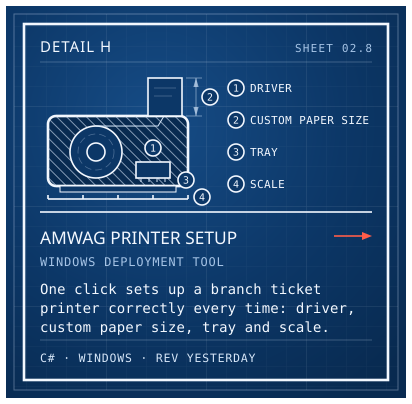</a><a href="https://github.com/abameda/Yosr-LMS">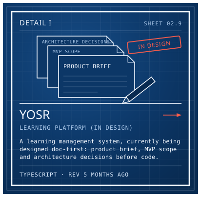</a><a href="https://github.com/abameda?tab=repositories">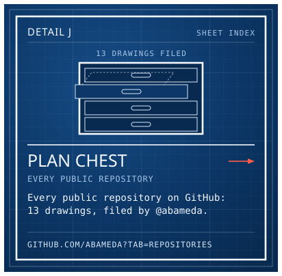</a>

<b>Read the drawing set as text</b> · projects, toolbox, contact

**Abdelhmeed Elshorbagy**, Creative engineer · Bilingual product builder (Arabic / English) · Cybersecurity enthusiast · Founder of DÖSE, an Egyptian niche fragrance house. Server Administrator at Amwag Travel (previously IT Help Desk), Minya, Egypt. Computer Science &amp; AI student, Minya National University.

**Principal assemblies**

- [CORTEX](https://cortex-pi-sable.vercel.app) · AI agency platform. Egypt's first autonomous AI agency: designs, builds and runs complete brand ecosystems. Next.js, TypeScript
- [DÖSE](https://www.abdelhmeed.com/work/dose-fragrance.html) · Fragrance brand + store (founder). A premium store for an Egyptian niche fragrance house: product storytelling, cart and discount logic, and the Find Your DÖSE discovery flow. Shopify, Liquid, TypeScript
- [AMWAG ATTENDANCE](https://www.abdelhmeed.com/work/amwag-attendance.html) · Production workforce platform. Bilingual attendance platform for a multi-branch company: branch and IP validation, role-based access, analytics, PDF reports, backups. Next.js 15, TypeScript, MySQL
- [BOSLA](https://r5depifinalproject.vercel.app) · Job-market intelligence (DEPI R5 final project). Pipeline + dashboard over 588,545 unique tech job postings from 8 sources, 159 countries and 1,475 skills, showing where the jobs are and what to learn next. Data pipeline, Dashboard

**Details**

- [CORTEX OPS](https://cortex-ops.vercel.app) · Internal command surface. The internal operations dashboard behind Cortex client workspaces and delivery. Next.js, TypeScript
- [THREAD](https://github.com/abameda/3D-Cloth-App) · 3D wardrobe app. Take photos, and Thread reconstructs your real avatar and clothes in 3D on your own computer, so you can try on outfits. React Native, Expo, COLMAP / OpenMVS
- [MNU SMS](https://sms-mnu.vercel.app) · University student management system. Student Management System for Minya National University: academic records, grades, attendance and transcripts. TypeScript
- [AMWAG PRINTER SETUP](https://github.com/abameda/Amwag-Printer-Driver) · Windows deployment tool. One click sets up a branch ticket printer correctly every time: driver, custom paper size, tray and scale. C#, Windows
- [YOSR](https://github.com/abameda/Yosr-LMS) · Learning platform (in design). A learning management system, currently being designed doc-first: product brief, MVP scope and architecture decisions before code. TypeScript

**Bill of materials** · Languages: TypeScript, JavaScript, C#, C++, Python, HTML/CSS · Frameworks: Next.js, React, React Native / Expo, Shopify / Liquid · Data: MySQL / MariaDB · Infra: Vercel, Windows Server, Linux, Git · Security: Kali Linux, Burp Suite

**Distribution** · [abdelhmeed.com](https://www.abdelhmeed.com) · [in/elshorbagy](https://www.linkedin.com/in/elshorbagy/) · [CV (PDF)](https://www.abdelhmeed.com/assets/Abdelhmeed-Elshorbagy-CV.pdf) · [@abameda](https://github.com/abameda)

<a href="https://github.com/abameda?tab=repositories">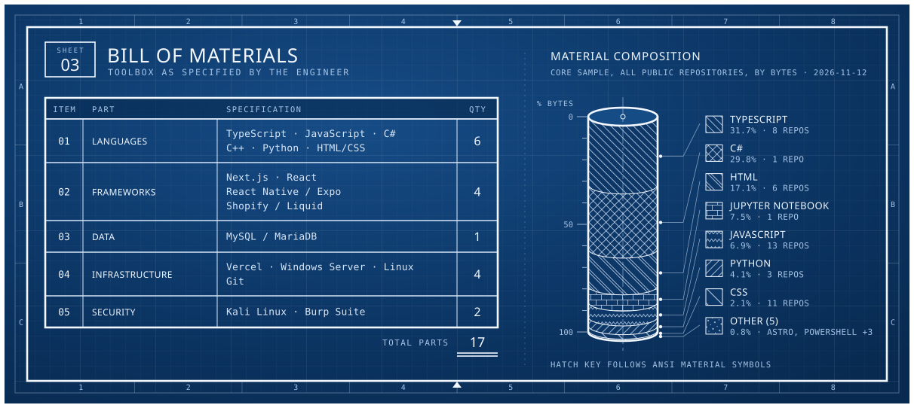</a>

<a href="https://github.com/abameda"></a>

<a href="https://www.abdelhmeed.com">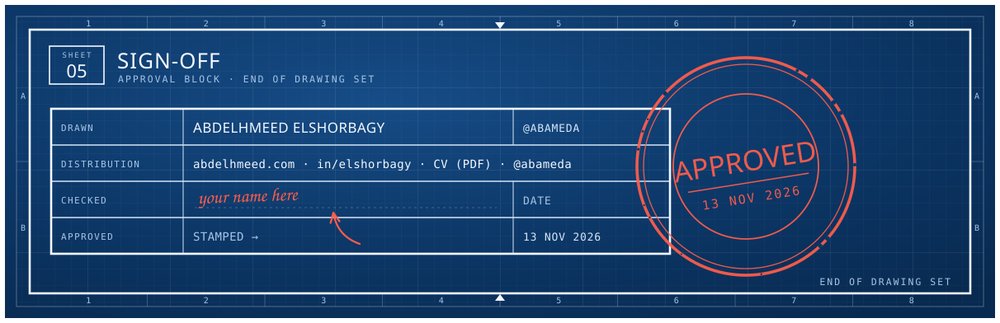</a>

<a href="https://www.abdelhmeed.com">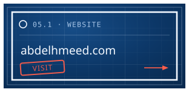</a><a href="https://www.linkedin.com/in/elshorbagy/">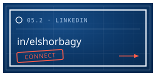</a><a href="https://www.abdelhmeed.com/assets/Abdelhmeed-Elshorbagy-CV.pdf">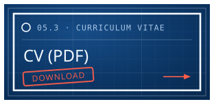</a><a href="https://github.com/abameda">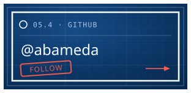</a>

<a href="https://www.abdelhmeed.com">Website</a> · <a href="https://www.linkedin.com/in/elshorbagy/">LinkedIn</a> · <a href="https://www.abdelhmeed.com/assets/Abdelhmeed-Elshorbagy-CV.pdf">CV (PDF)</a> · <a href="https://github.com/abameda">GitHub</a> · drawing set regenerated daily from live GitHub data, last 2026-11-13

This profile exists in three worlds: <a href="https://github.com/abameda">The City</a> · <a href="https://github.com/abameda/abameda/tree/main/worlds/circuit#readme">The Circuit Board</a> · <b>The Blueprint</b>

