

<a href="https://www.abdelhmeed.com"><picture><source media="(max-width: 600px)" srcset="assets/m-hero.svg"></picture></a> 
<a href="https://cortex-pi-sable.vercel.app"><picture><source media="(max-width: 600px)" srcset="assets/m-part-cortex.svg"></picture></a> 
<a href="https://www.abdelhmeed.com/work/dose-fragrance.html"><picture><source media="(max-width: 600px)" srcset="assets/m-part-dose.svg">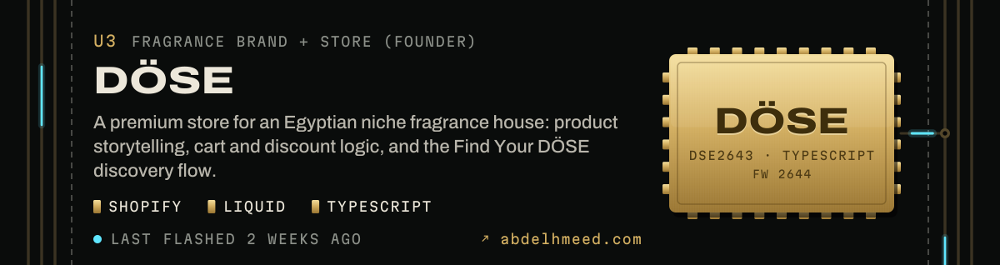</picture></a> 
<a href="https://www.abdelhmeed.com/work/amwag-attendance.html"><picture><source media="(max-width: 600px)" srcset="assets/m-part-attendance.svg">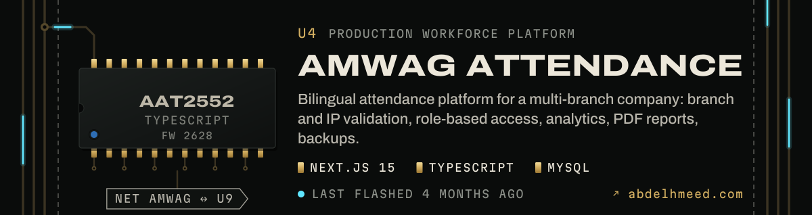</picture></a> 
<a href="https://r5depifinalproject.vercel.app"><picture><source media="(max-width: 600px)" srcset="assets/m-part-bosla.svg">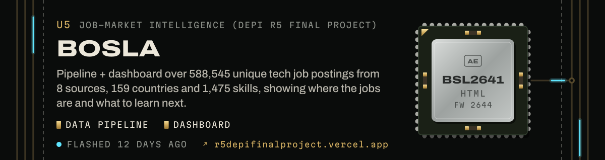</picture></a> 
<a href="https://cortex-ops.vercel.app"><picture><source media="(max-width: 600px)" srcset="assets/m-part-cortex-ops.svg">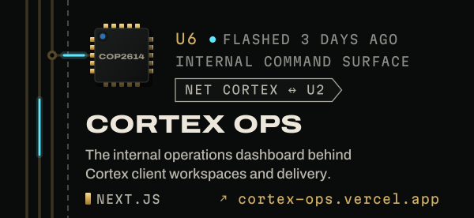</picture></a><a href="https://github.com/abameda/3D-Cloth-App"><picture><source media="(max-width: 600px)" srcset="assets/m-part-thread.svg">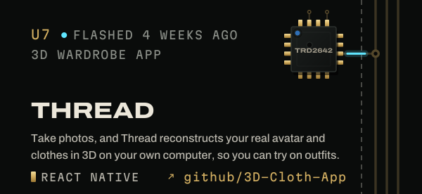</picture></a> 
<a href="https://sms-mnu.vercel.app"><picture><source media="(max-width: 600px)" srcset="assets/m-part-mnu-sms.svg">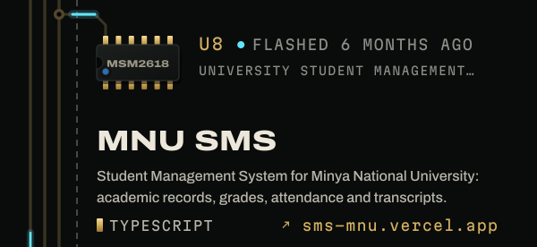</picture></a><a href="https://github.com/abameda/Amwag-Printer-Driver"><picture><source media="(max-width: 600px)" srcset="assets/m-part-printer.svg">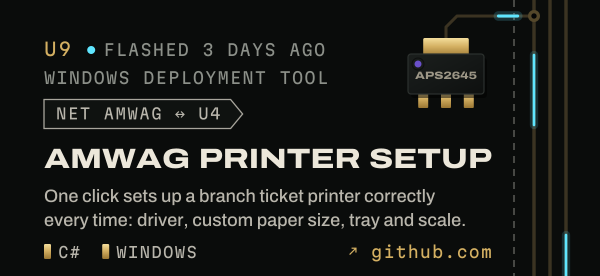</picture></a> 
<a href="https://github.com/abameda/Yosr-LMS"><picture><source media="(max-width: 600px)" srcset="assets/m-part-yosr.svg">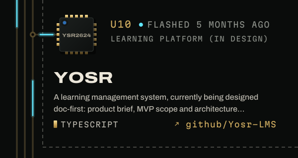</picture></a><a href="https://github.com/abameda?tab=repositories"><picture><source media="(max-width: 600px)" srcset="assets/m-part-dnp.svg">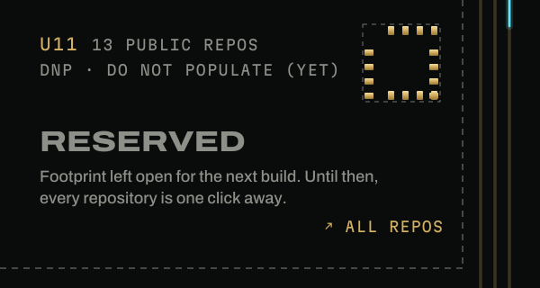</picture></a> 
<a href="https://github.com/abameda?tab=repositories"><picture><source media="(max-width: 600px)" srcset="assets/m-bom.svg">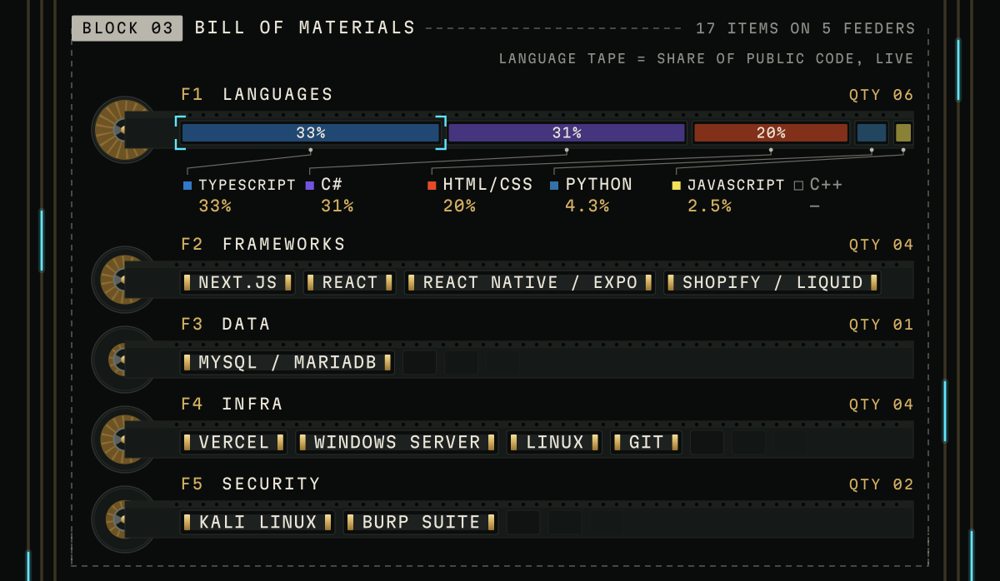</picture></a> 
<a href="https://github.com/abameda"><picture><source media="(max-width: 600px)" srcset="assets/m-scope.svg"></picture></a> 
<a href="https://www.abdelhmeed.com">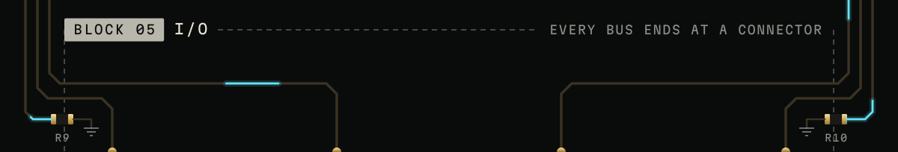</a> 
<a href="https://www.abdelhmeed.com"></a><a href="https://www.linkedin.com/in/elshorbagy/">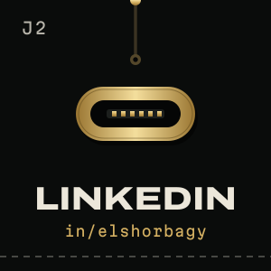</a><a href="https://www.abdelhmeed.com/assets/Abdelhmeed-Elshorbagy-CV.pdf">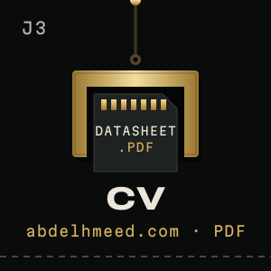</a><a href="https://github.com/abameda">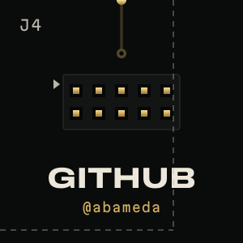</a> 
<a href="https://www.abdelhmeed.com">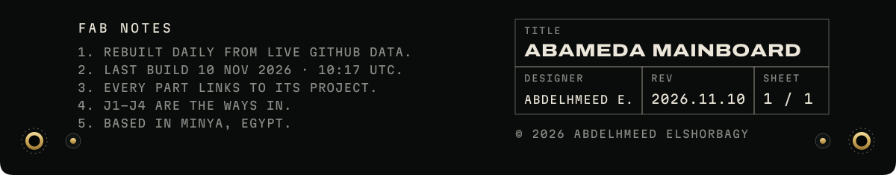</a>

<b>Abdelhmeed Elshorbagy</b> · Server Administrator at Amwag Travel · Minya, Egypt 
Creative engineer · Bilingual product builder (Arabic / English) · Cybersecurity enthusiast · Founder of DÖSE, an Egyptian niche fragrance house 
<a href="https://www.abdelhmeed.com">Website</a> · <a href="https://www.linkedin.com/in/elshorbagy/">LinkedIn</a> · <a href="https://www.abdelhmeed.com/assets/Abdelhmeed-Elshorbagy-CV.pdf">CV (PDF)</a> · <a href="https://github.com/abameda">GitHub</a>

<b>U1 datasheet</b> · plain text

**Abdelhmeed Elshorbagy** · Server Administrator at Amwag Travel (previously IT Help Desk) · Computer Science & AI student, Minya National University · Minya, Egypt

- **[CORTEX](https://cortex-pi-sable.vercel.app)** · AI agency platform. Egypt's first autonomous AI agency: designs, builds and runs complete brand ecosystems.
- **[CORTEX OPS](https://cortex-ops.vercel.app)** · Internal command surface. The internal operations dashboard behind Cortex client workspaces and delivery.
- **[DÖSE](https://www.abdelhmeed.com/work/dose-fragrance.html)** · Fragrance brand + store (founder). A premium store for an Egyptian niche fragrance house: product storytelling, cart and discount logic, and the Find Your DÖSE discovery flow.
- **[AMWAG ATTENDANCE](https://www.abdelhmeed.com/work/amwag-attendance.html)** · Production workforce platform. Bilingual attendance platform for a multi-branch company: branch and IP validation, role-based access, analytics, PDF reports, backups.
- **[BOSLA](https://r5depifinalproject.vercel.app)** · Job-market intelligence (DEPI R5 final project). Pipeline + dashboard over 588,545 unique tech job postings from 8 sources, 159 countries and 1,475 skills, showing where the jobs are and what to learn next.
- **[THREAD](https://github.com/abameda/3D-Cloth-App)** · 3D wardrobe app. Take photos, and Thread reconstructs your real avatar and clothes in 3D on your own computer, so you can try on outfits.
- **[MNU SMS](https://sms-mnu.vercel.app)** · University student management system. Student Management System for Minya National University: academic records, grades, attendance and transcripts.
- **[AMWAG PRINTER SETUP](https://github.com/abameda/Amwag-Printer-Driver)** · Windows deployment tool. One click sets up a branch ticket printer correctly every time: driver, custom paper size, tray and scale.
- **[YOSR](https://github.com/abameda/Yosr-LMS)** · Learning platform (in design). A learning management system, currently being designed doc-first: product brief, MVP scope and architecture decisions before code.

- **Languages:** TypeScript, JavaScript, C#, C++, Python, HTML/CSS
- **Frameworks:** Next.js, React, React Native / Expo, Shopify / Liquid
- **Data:** MySQL / MariaDB
- **Infra:** Vercel, Windows Server, Linux, Git
- **Security:** Kali Linux, Burp Suite

Board re-routed daily from live GitHub data · last build 2026.11.12

This profile exists in three worlds: <a href="https://github.com/abameda">The City</a> · <b>The Circuit Board</b> · <a href="https://github.com/abameda/abameda/tree/main/worlds/blueprint#readme">The Blueprint</a>

